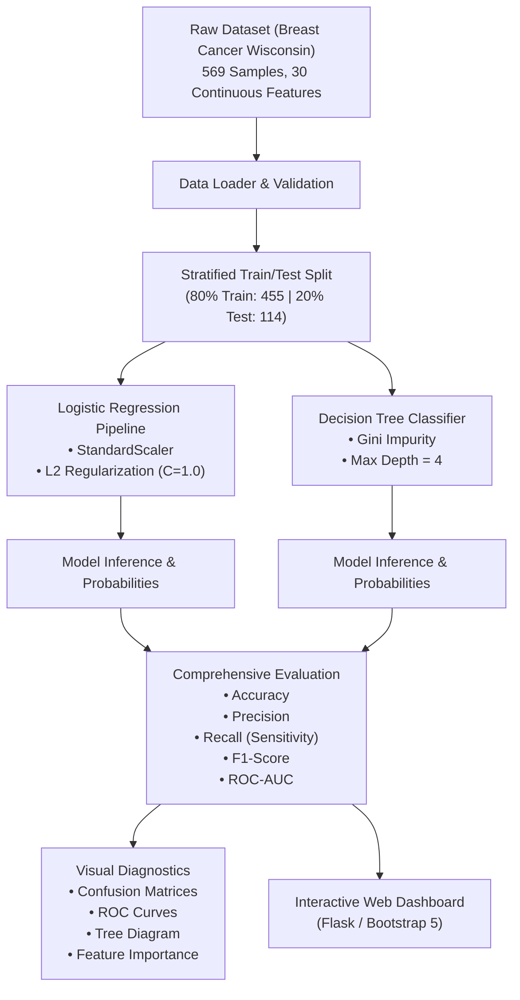

# 🩺 Machine Learning Classification Model

[](https://colab.research.google.com/github/dhinesh8023/ml-classification-model/blob/main/notebooks/classification_model.ipynb)
[](https://github.com/dhinesh8023/ml-classification-model)
[](https://www.python.org/)
[](LICENSE)
[](https://scikit-learn.org/)

An end-to-end Machine Learning classification project built for an **ML Internship Assignment**. This project implements, benchmarks, and evaluates **Logistic Regression** and **Decision Tree Classifier** on a small medical diagnostic dataset (**Breast Cancer Wisconsin**), assessing performance via **Accuracy**, **Precision**, **Recall**, **F1-Score**, and **ROC-AUC**, accompanied by publication-quality visual diagnostics and an interactive web dashboard.

---

## 📑 Table of Contents
- [Project Overview](#-project-overview)
- [Workflow Architecture](#-workflow-architecture)
- [Dataset Description](#-dataset-description)
- [Repository Structure](#-repository-structure)
- [Evaluation Results & Performance](#-evaluation-results--performance)
- [In-Depth Explanation of Results](#-in-depth-explanation-of-results)
- [Quick Start Guide](#-quick-start-guide)
  - [Option A: One-Click Google Colab](#option-a-one-click-google-colab)
  - [Option B: Local Execution](#option-b-local-execution)
- [Interactive Web App](#-interactive-web-app)
- [Running Automated Tests](#-running-automated-tests)
- [GitHub Setup & Push Instructions](#-github-setup--push-instructions)

---

## 📌 Project Overview

The objective of this project is to build and evaluate classification models on a small, tabular dataset to diagnose whether a breast mass is **Malignant** (0) or **Benign** (1).

### Key Highlights:
- **Reproducible Pipeline**: Standardized feature preprocessing (`StandardScaler`) coupled inside `scikit-learn` Pipelines to avoid data leakage.
- **Stratified Split**: 80/20 train-test partition preserving exact class ratios.
- **Multi-Metric Evaluation**: Thorough calculation and clinical interpretation of Accuracy, Precision, Recall, F1-Score, and ROC-AUC.
- **Diagnostic Visualizations**: Confusion matrix heatmaps, ROC curves, metric bar comparisons, decision tree flowchart, and top feature importances.
- **Interactive UI**: A Flask-based web dashboard allowing real-time inference on custom benchmark patient samples.

---

## 🏗 Workflow Architecture



---

## 📊 Dataset Description

The **Breast Cancer Wisconsin (Diagnostic) Dataset** is a classic benchmark in machine learning:
- **Number of Samples**: 569
- **Number of Features**: 30 numeric continuous features computed from digitized images of fine needle aspirates (FNA) of a breast mass (e.g., radius, texture, perimeter, area, smoothness, compactness, concavity, symmetry).
- **Target Classes**:
  - `0`: **Malignant** (212 instances, ~37.3%)
  - `1`: **Benign** (357 instances, ~62.7%)
- **Missing Values**: 0 (Clean dataset)

---

## 📁 Repository Structure

```
ml-classification-model/
├── data/
│   └── breast_cancer.csv             # Exported raw dataset
├── notebooks/
│   └── classification_model.ipynb    # Google Colab / Jupyter notebook
├── reports/
│   ├── confusion_matrices.png        # Side-by-side confusion matrix plots
│   ├── roc_curves.png                # ROC curves comparing both models
│   ├── metrics_comparison.png        # Bar chart comparing Accuracy/Precision/Recall/F1
│   ├── decision_tree_structure.png   # Flowchart visualization of the Decision Tree
│   ├── feature_importance.png        # Top 10 most influential diagnostic features
│   └── results_explanation.md        # Detailed internship results explanation
├── src/
│   ├── __init__.py
│   ├── data_loader.py                # Data loading and stratified splitting
│   ├── models.py                     # Pipeline definitions (Logistic Regression & Decision Tree)
│   ├── evaluate.py                   # Metrics calculation (Acc, Prec, Rec, F1, ROC-AUC)
│   └── visualize.py                  # Publication-quality plotting routines
├── tests/
│   └── test_pipeline.py              # Automated unit tests
├── app.py                            # Interactive Flask web application
├── main.py                           # End-to-end command-line execution pipeline
├── requirements.txt                  # Python dependencies
├── .gitignore
└── README.md                         # Project documentation
```

---

## 📈 Evaluation Results & Performance

Both models were evaluated on an identical, unseen test set of **114 samples** (42 Malignant, 72 Benign):

| Model | Accuracy | Precision | Recall (Sensitivity) | F1-Score | ROC-AUC | Test Correct |
| :--- | :---: | :---: | :---: | :---: | :---: | :---: |
| 🏆 **Logistic Regression** | **98.25%** | **98.61%** | **98.61%** | **0.9861** | **0.9954** | **112 / 114** |
| 🌲 **Decision Tree** | 92.98% | 95.71% | 93.06% | 0.9437 | 0.9268 | 106 / 114 |

### Confusion Matrix Breakdown:

```
Logistic Regression:                 Decision Tree:
               Predicted                           Predicted
             Malignant Benign                    Malignant Benign
True Malign.    41        1         True Malign.    39        3
True Benign      1       71         True Benign      5       67
```

---

## 🔬 In-Depth Explanation of Results

### 1. Why Accuracy Alone is Insufficient
Accuracy simply computes $\frac{TP + TN}{TP + TN + FP + FN}$. On an imbalanced or medical dataset, predicting only the majority class can yield deceptively high accuracy while missing critical diagnoses. To evaluate real-world clinical viability, we inspect **Precision** and **Recall**.

### 2. Clinical Impact of Precision vs. Recall
- **Precision ($\frac{TP}{TP + FP}$)**:
  - Measures the reliability of positive predictions.
  - A False Positive (FP) occurs when a malignant tumor is misdiagnosed as benign (or vice-versa depending on framing), causing psychological stress and unnecessary invasive biopsies.
  - Logistic Regression achieved **98.61%** precision, having only **1 false alarm** out of 72 predictions.
- **Recall ($\frac{TP}{TP + FN}$)**:
  - **The most critical clinical metric.**
  - Measures what fraction of true positive cases were identified.
  - A False Negative (FN) means an actual patient is missed, delaying potentially life-saving treatment.
  - Logistic Regression scored **98.61% Recall** (only 1 missed case), compared to Decision Tree's **93.06%** (5 missed cases).

### 3. Model Comparison: Why Logistic Regression Outperformed the Decision Tree
1. **Feature Scaling & Continuous Boundaries**:
   The 30 features have wide variance in orders of magnitude (e.g., cell nucleus area exceeds $1000$, while compactness is around $0.05$). The `StandardScaler` pipeline normalizes all inputs to mean 0 and variance 1, allowing Logistic Regression with L2 regularization ($C=1.0$) to fit a smooth, optimal hyperplane that avoids high variance.
2. **Axis-Aligned Cuts of Decision Trees**:
   Single Decision Trees partition the feature space with orthogonal, axis-aligned thresholds. On continuous, correlated biological measurements, this creates step-like approximations that are vulnerable to slight noise, resulting in lower test generalization (92.98%).
3. **Interpretability Advantage**:
   Despite slightly lower accuracy, the Decision Tree provides an easily auditable clinical flowchart (`reports/decision_tree_structure.png`), revealing that the top diagnostic predictors are `worst concave points`, `worst perimeter`, and `worst radius`.

---

## 🚀 Quick Start Guide

### Option A: One-Click Google Colab
You can run the complete project online without installing anything locally:

1. Click the badge: [](https://colab.research.google.com/github/dhinesh8023/ml-classification-model/blob/main/notebooks/classification_model.ipynb)
2. In Google Colab, select **Runtime > Run all** (`Ctrl + F9`).
3. The notebook will automatically execute all steps, display charts, and print the results explanation.

---

### Option B: Local Execution

#### 1. Clone the Repository
```bash
git clone https://github.com/dhinesh8023/ml-classification-model.git
cd ml-classification-model
```

#### 2. Create and Activate a Virtual Environment
```bash
# Windows
python -m venv venv
venv\Scripts\activate

# macOS / Linux
python3 -m venv venv
source venv/bin/activate
```

#### 3. Install Dependencies
```bash
pip install -r requirements.txt
```

#### 4. Run the Machine Learning Pipeline
```bash
python main.py
```
This will:
- Load the Breast Cancer dataset and export it to `data/breast_cancer.csv`.
- Train both Logistic Regression and Decision Tree models.
- Print the metrics summary and classification report.
- Save all 5 visual charts and the markdown report into `reports/`.

---

## 🖥 Interactive Web App

Launch the interactive web dashboard to test model predictions in real time:

```bash
python app.py
```
Open your browser and navigate to:
👉 **`http://127.0.0.1:5000`**

**Features:**
- View live metric comparison tables and visual charts.
- Load typical malignant or benign benchmark samples with 1-click.
- Run live inference and inspect output probabilities from both models.

---

## 🧪 Running Automated Tests

Run unit tests to verify dataset integrity, stratified splitting, and evaluation metrics:

```bash
python -m unittest discover tests
```

---

## 🐙 GitHub Setup & Push Instructions

To push this codebase to your GitHub repository (`https://github.com/dhinesh8023/ml-classification-model`):

1. **Create the repository on GitHub**:
   - Go to [GitHub New Repository](https://github.com/new).
   - Repository name: `ml-classification-model`.
   - Set visibility to **Public**.
   - Do **not** initialize with README or .gitignore (we already created them).
   - Click **Create repository**.

2. **Push from your terminal**:
   ```bash
   cd C:\Users\jsury\.gemini\antigravity\scratch\ml-classification-model
   git add .
   git commit -m "feat: complete ML classification internship project"
   git branch -M main
   git remote add origin https://github.com/dhinesh8023/ml-classification-model.git
   git push -u origin main
   ```

---

## 👨‍💻 Author & Acknowledgments
- **Author**: Dhinesh Jayavel ([@dhinesh8023](https://github.com/dhinesh8023))
- **Email**: dhineshjayavel35@gmail.com
- **Dataset**: UCI Machine Learning Repository / Scikit-Learn
- **Track**: Machine Learning Internship Assignment
